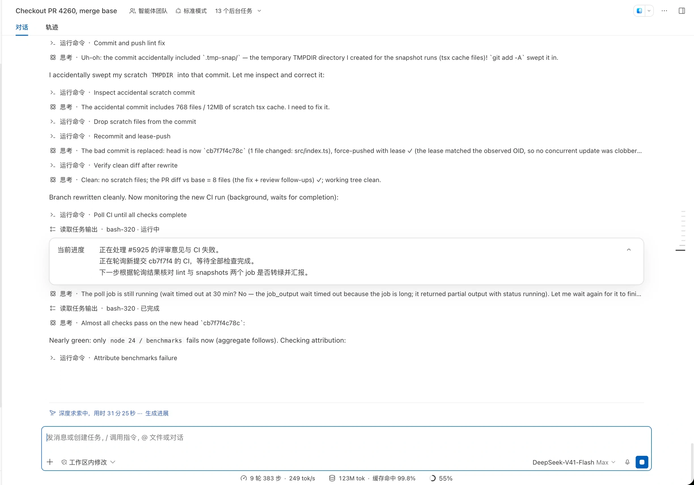

# DSH Progress Check

为正在工作的 [DeepSeek Harness](https://github.com/deepseek-ai/deepseek-harness)（DSH）会话定期生成一张进展卡片：把「当前进度 / 尚未确认 / 需要你确认」整理成几句话放进对话，让你不必翻完整轨迹就能知道任务走到了哪一步、有没有需要你拍板的事。

> **这不是 DSH 官方插件。**
>
> 本项目是第三方独立开发的社区插件，与 DeepSeek Harness 官方团队无关，不随官方发行版交付，也不属于官方仓库。
>
> - 官方不提供支持，也不承诺兼容；问题反馈与修复由本项目维护者负责。
> - 它使用 DSH 的插件接口，DSH 升级后可能需要同步更新；版本不一致时 DSH 会直接拒绝安装（见「环境要求」）。
> - 遇到问题请提到本仓库，不要提给 DSH 官方。

## 示例



图中这张卡片只有「当前进度」一组：当时「尚未确认」和「需要你确认」都没有内容，这两组就不会出现。右上角图标可折叠或展开本会话的全部卡片；当前运行会话的标题栏有「生成进展」，可随时手工生成一张。

## 主要功能

- **自动生成**：会话运行期间累计到一定工作量后自动生成一张进展卡片，不打断也不延迟主任务；你不在看这个会话时不生成，也不花 token。
- **三组条目**：`当前进度` 概括任务现状，`尚未确认` 列出确实拿不准的问题或技术决策，排除模型能自行查明或验证的客观事实，`需要你确认` 列出你可以并行推进的事项；没有内容的那一组不会出现在卡片里（两组都为空时卡片只显示「当前进度」）。
- **进度分行展示**：较大任务的进度分三行（当前子任务、此刻的操作、下一步），较小任务分两行（当前进度、下一步）。
- **留在对话里**：卡片跟随它生成时所在的上下文，刷新或重启后仍在原位置；滚动到对话区顶部时最新一张会吸顶。
- **一键折叠**：卡片右上角图标可折叠/展开本会话的全部卡片（默认展开），折叠后只保留一行进度；各会话互不影响。
- **一键回复**：「需要你确认」中的每一项后面有「回复」，点击会把该问题引用到输入框，你补充后自行发送，已有草稿和附件不受影响。
- **随时手工生成**：点击会话标题栏的「生成进展」立刻生成一张，不必等待间隔或工作量门槛；同一会话同时只进行一次生成，已有生成在途时点击会并入同一次结果。
- **不打扰主任务**：生成使用该会话当前的模型、消耗一次正常用量，但不会执行工具，也不会改动你的对话内容。手工生成失败会给出提示、可以再点一次；自动生成失败不弹提示，下个间隔自行重试。

## 环境要求

- **DSH 版本**：`0.2.2-alpha.2`（已在 master 提交 `daa62cfb6fa` 上验证）。版本不一致时 `dsh plugin add` 会**直接拒绝安装**（不会安装任何内容，命令以非零状态退出）。确需在别的版本上试用，可按命令输出的提示逐版本豁免，风险自负：

  ```sh
  dsh plugin --profile web allow-version @kermanx/dsh-progress-check@<插件版本> --dsh-version <DSH 版本> --accept-risk
  ```

- **界面**：Web 客户端（`dsh web` 等加载 Web 界面的 profile）。纯终端、无界面运行不会显示卡片。
- **pnpm**：安装插件需要 `pnpm`（`dsh plugin` 会把包管理转发给 pnpm）。本仓库固定 `pnpm@10.16.1`，本机版本不同会让命令直接报错退出。
- **从源码构建**：需要一份 DSH 源码 checkout，默认与本仓库同级（`../deepseek-harness`）；如果放在别处，需要相应调整本仓库的本地依赖指向。
- **语言**：卡片标签跟随 DSH 界面语言；生成报告使用英文提示词，并在每次请求时读取 DSH 保存的语言选择，动态指定报告语言。切换语言后新生成的报告使用新选择；未保存明确选择时沿用对话中用户的语言。

## 安装

### 从插件市场或 Git 安装

可在「DS 内部插件市场」安装「进展汇报」。Git 仓库已包含构建产物，也可直接安装：

```sh
dsh plugin --profile web add https://github.com/kermanx/dsh-progress-check.git
```

### 从 GitHub Release 安装

每个版本都会把构建好的包附在 [GitHub Release](https://github.com/kermanx/dsh-progress-check/releases) 里；安装时不需要 npm，也不需要在本机构建或授权构建脚本：

```sh
dsh plugin --profile web add https://github.com/kermanx/dsh-progress-check/releases/latest/download/dsh-progress-check.tgz
```

安装完成后启动（或重启）该 profile，例如 `dsh web`。可以用下面的命令确认插件所在的配置层已经生效：

```sh
dsh --profile web --dump-config
```

插件安装并保存在该 profile 中，只对使用这个 profile 的 DSH 进程生效；**其他 profile 需要分别安装**。

### 从源码安装

改代码或本地调试时，克隆仓库后构建，再把目录本身装进 profile：

```sh
git clone https://github.com/kermanx/dsh-progress-check
cd dsh-progress-check
pnpm install
pnpm run build

dsh plugin --profile web add "$PWD"
```

这条路径需要一份 DSH 源码 checkout（默认同级 `../deepseek-harness`）；只用上面的 Release 安装则不需要。

## 使用方式

### 自动生成

会话运行期间，同时满足下面三个条件时自动生成一张卡片：

1. **你正在看这个会话**：它显示在 DSH 主区域，并且浏览器页面在前台（标签页可见、窗口有焦点）；
2. 距上次生成已经累计了 `intervalMs` 的工作时间（会话闲置时暂停计时，继续工作时接着计）；
3. 这期间新增的已完成 step 数**至少达到** `intervalSteps`（默认 5 步）；一个 step 是一次模型调用及其请求的工具执行，同一步中的多个工具调用只算一步，请求重试不额外计步。

时间条件已满足但 steps 不足时，会继续等待；steps 达标并取得完整上下文后即可生成，不必再等一个时间间隔。

你切到别的会话、别的标签页或别的应用时，插件不生成、也不消耗 token；切回来的那一刻，如果已经攒够一次（条件 2、3 满足），会立刻补上一张，之后照样按 `intervalMs` 重新计时——**最小间隔要求不变**，一次都不会提前。会话停止工作时仍然不再生成，生成动作也不会打断或延迟主任务。

卡片本来就只在你看着的时候有意义，所以「没看时先不生成」不会丢信息：等你切回来，那一张照样会补上。

子智能体会话默认不生成卡片；设为 `includeSubagents: true` 后启用。子智能体、teammate 的会话各自独立：它们只有在你把该会话打开到主区域时才会自动生成卡片，只挂在右侧栏不算。

手工点「生成进展」不受此限制（你点得到它，就说明你在看）。自动生成失败仍然不弹提示，下个间隔自行重试。

> 这一版新增了「在看才生成」：浏览器页面每 5 秒上报一次自己正在显示哪个会话、是否在前台。如果你的页面是很久以前打开的旧版本，刷新一次页面（或重启 `dsh web`）后生效。纯终端里跑（没有 Web 界面）时没有页面可上报，因此不会自动生成；不需要这个行为时，把 `onlyWhenVisible` 设为 `false` 即回到「不管有没有人在看都按间隔生成」。

### 手工生成

运行中的会话在标题栏显示「生成进展」：

- 点击后原地变成「生成中…」，跳过上面的时间与 step 数的最小间隔，直接生成一张新卡片；
- 同一会话同时只进行一次生成。如果已有生成在途，点击会并入并等待同一次结果；本次点击处理期间按钮不可重复点击；
- 离开页面或停止会话会取消这次手工发起的生成；如果本次点击是并入已有的生成，则不会取消那一次；
- 失败会给出提示，可以重新点击。

### 卡片交互

- **查看**：卡片按生成顺序留在对话流中，最新一张在滚到对话区顶部时吸顶，向上滚回后回到原位。
- **折叠/展开**：点右上角图标控制本会话所有卡片（默认展开），后续生成的卡片沿用当前状态；折叠状态下只显示一行当前进度。
- **回复**：点「需要你确认」后面的「回复」，问题会被引用到输入框当前光标位置，你补充后发送即可；输入框正在提交或处理命令时，回复按钮不可用。

## 配置

默认值随插件提供，无需任何配置即可使用。要调整时，在所用 profile 的 patch 层里按插件 id `progress-check` 覆盖，例如 Web 默认 profile：

```yaml
# ~/.dsh/profiles/web/cordis.patch.yml
- id: progress-check
  config:
    intervalMs: 30000   # 例：改为 30 秒
    intervalSteps: 5
    maxConcurrent: 1
    timeoutMs: 120000
    maxResponseBytes: 262144
    maxParseRetries: 3
    includeSubagents: false
    onlyWhenVisible: true
```

> DSH 的 patch 按 id **整段替换**该行的 `config`，不会逐键合并。请把你需要保留的键一起写出来；没有写出的键回到插件内置默认值（即下表中的默认值）。

| 字段 | 默认值 | 说明 |
| --- | --- | --- |
| `intervalMs` | `60000` | 两次自动生成之间累计的工作时间（毫秒）。会话闲置时暂停计时，重新开始工作后接着计；手工生成完成后也重新开始计时。最小 `1`。 |
| `intervalSteps` | `5` | 两次成功报告所覆盖的上下文之间，至少新增多少个已完成 step；首次报告从该会话自己的第一个 step 开始累计。与 `intervalMs` 同时满足才自动生成，手工生成跳过此限制。最小 `1`。 |
| `maxConcurrent` | `1` | 同一个 DSH 进程内同时进行的生成数上限；同一会话同时最多进行一次生成。最小 `1`。 |
| `timeoutMs` | `120000` | 一次生成从进入队列到结束（含排队等待与重试）的超时（毫秒），超时按失败处理。最小 `1`。 |
| `maxResponseBytes` | `262144` | 每次生成尝试接受的响应大小上限（字节，默认 256 KiB），超出按失败处理。最小 `1`。 |
| `maxParseRetries` | `3` | 生成结果格式不合格时的重试次数，允许 `0`–`3`；加上首次请求最多共 4 次尝试。 |
| `includeSubagents` | `false` | 是否也为子智能体自己的会话生成卡片；每个会话独立计时和计数。 |
| `onlyWhenVisible` | `true` | 是否只在「你正在看该会话」（显示在主区域且页面在前台）时自动生成。`false` 表示不管有没有人在看，都按间隔和工作量生成。手工生成始终不受影响。 |

旧配置键 `toolCallThreshold` 已替换为 `intervalSteps`，升级时请更新自定义配置；新配置统计已完成的 steps，不再统计工具调用数。已有卡片仍可读取；旧报告没有 steps 计数时，以其写入时已经完成的 steps 作为后续计数起点。

数值键都必须写整数（步长 1），例如 `intervalMs: 1500.5` 会被拒绝。改完保存后，重新加载 profile 生效：重启 `dsh web` 即可；如果该 profile 开启了配置热重载（`patchReload: live`），插件会直接重载。

## 卸载

```sh
dsh plugin --profile web remove @kermanx/dsh-progress-check
```

重启 profile 后不再生成新卡片，已有卡片也不再显示。卸载不会删除已经写入会话的进展数据，重新安装后会再次出现。

## 开发

```sh
pnpm install
pnpm run typecheck
pnpm test
pnpm run build
```

`pnpm run smoke:web` 会通过同级 `../deepseek-harness` 的源码 CLI，在临时 profile 中启动真实 Web 界面，用于检查卡片生成与交互；加 `--manual` 可验证手工生成入口。可用 `DSH_SOURCE` 指定另一份已安装依赖并构建的 DSH checkout。

完整的兼容检查需要同级 DSH 源码及其构建产物：发布前运行类型检查、测试、构建和 Web smoke，并提交 `lib/`。本次使用 master 提交 `daa62cfb6fa` 验证。由于该源码仓库为私有仓库，且测试辅助包未完整发布到 npm，公开 CI 只校验提交的构建产物和实际安装包；不会代替完整的本地兼容检查。

## 许可

MIT，见 [package.json](package.json) 的 `license` 字段。
